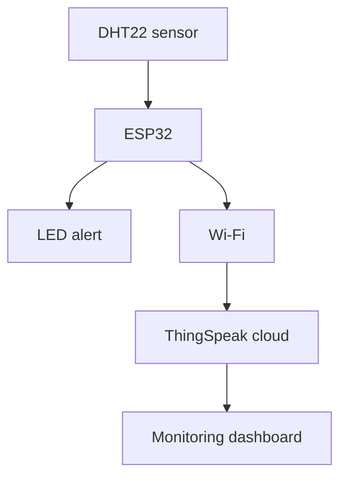

# Smart Room IoT Monitoring System

An educational IoT prototype developed by **Shivani Gupta** using ESP32, DHT22, Wokwi and ThingSpeak. It monitors temperature and humidity, activates a local LED alert and uploads readings to a cloud dashboard.

## Live simulation

[Open the Wokwi project](https://wokwi.com/projects/481549255263096833)

## Features

- Temperature and humidity sampling approximately every two seconds.
- Automatic LED alert at temperatures of 30°C or above.
- Wi-Fi connectivity and ThingSpeak uploads approximately every 20 seconds.
- Live temperature, humidity and LED status charts.

## Architecture

## Components and wiring

| Component pin | Connection |
|---|---|
| DHT22 VCC | ESP32 3V3 |
| DHT22 SDA | GPIO 15 |
| DHT22 GND | GND |
| GPIO 2 | 220 ohm resistor |
| Resistor other terminal | LED anode |
| LED cathode | GND |

DHT22 NC is unused.

## Getting started

1. Open the Wokwi simulation or create an ESP32 project using the supplied sketch and circuit configuration.
2. Install the DHT sensor library, Adafruit Unified Sensor and ThingSpeak.
3. Create a ThingSpeak channel with Field 1 (Temperature), Field 2 (Humidity), Field 3 (LED Status).
4. Set your channel ID and Write API Key in your private copy of sketch.ino. Never commit or publicly share real credentials.
5. Start simulation and open the serial monitor at 115200 baud.
6. Change the DHT22 sliders and wait for the next upload. Check the channel's Private View.

The included diagram.json is a reconstructed circuit configuration; the linked Wokwi project is the original working simulation.

## Demonstrated results

During the original simulation, the serial monitor reported 42.60°C, 45.50% humidity, LED ON and a successful cloud upload. The ThingSpeak temperature and humidity charts displayed matching readings. LED status monitoring was also confirmed by the project author.

| Temperature | Expected LED status |
|---|---|
| Below 30°C | OFF (0) |
| 30°C or above | ON (1) |

## Educational applications

This project demonstrates sensor acquisition, microcontroller programming, conditional automation, wireless networking, API communication and cloud visualization. Hardware is simulated; cloud communication is real.

## Future improvements

- Configurable alert thresholds
- Additional environmental sensors
- Offline buffering and improved connection recovery
- Secure cloud transport and credential management
- Physical hardware validation

## Author

Shivani Gupta — Assistant Professor

